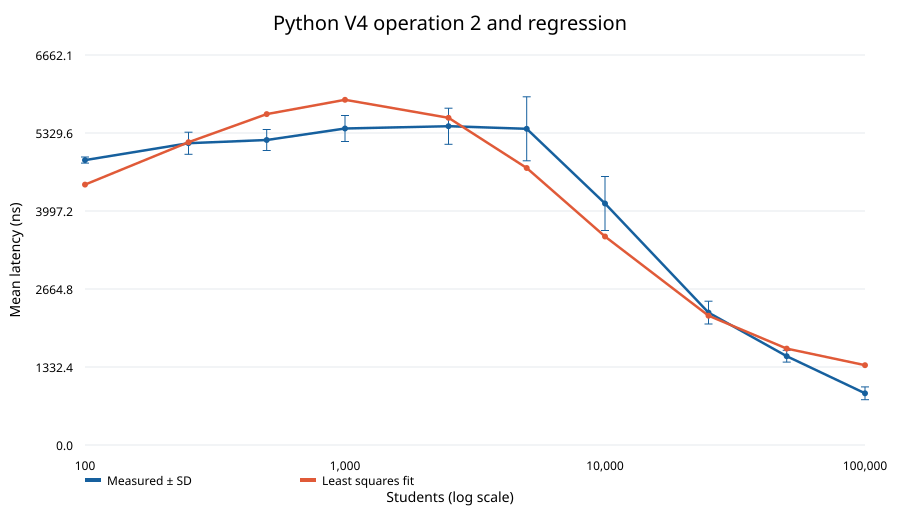
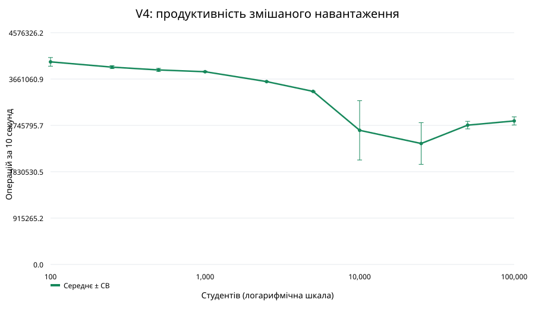
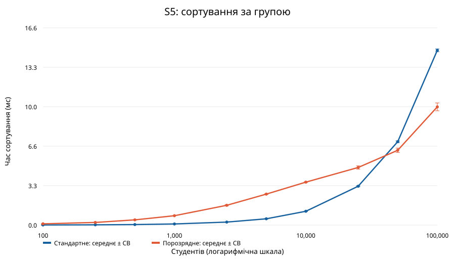

# Звіт про вимірювання V4 та S5 на Python

Призначений варіант: V4, співвідношення операцій 50:100:100, S5 — сортування за групою. Використано стандартну бібліотеку Python.

Середовище: Python 3.14.8, Darwin arm64.

## Завдання I: три реалізації для 100 000 студентів

Усі реалізації отримують однакову заздалегідь підготовлену послідовність із 25 000 операцій. Кожний перемішаний блок із 250 операцій містить рівно 50, 100 і 100 операцій типів 1, 2 та 3. Поштові адреси й цільові групи наявні у вхідних даних. У першій половині виконуються випадкові перенесення до іншої групи, у другій — їх скасування у зворотному порядку, перемежовані випадково впорядкованими запитами. Кожне перенесення змінює групу, а повний цикл відновлює початкову базу, тому повторення циклу зберігає реальні зміни. Це оборотне навантаження, а не потік незалежних оновлень. Підготовку й перевірку виключено з вимірювань. Останні блоки можуть трохи збільшити тривалість понад 10 секунд; нормована продуктивність це враховує.

| Реалізація | Структури даних | Виконано операцій | Час, с | Операцій за 10 с |
|---|---|---:|---:|---:|
| vector_scan | список, тимчасовий словник груп | 1,632 | 10.166 | 1,605 |
| aggregate_map | словник пошти, словник агрегатів груп | 7,072 | 10.021 | 7,057 |
| ranked_index | словники пошти й груп, множини рівних максимумів, обмежені купи максимумів | 3,033,920 | 10.000 | 3,033,901 |

**Переможець: `ranked_index`.** Перегляд списку потребує O(n) для кожної операції. Словник агрегатів змінює групу за очікуваний час O(1), а для запитів максимуму переглядає g груп. Індекс максимумів використовує словники, точні середні у вигляді `Fraction`, множини рівних максимумів та обмежені купи з відкладеним видаленням; оновлення мають очікувану амортизовану вартість O(log g), а повернення k груп-переможців — амортизовану O(k). Запити максимуму становлять 60% навантаження.

## Переможець для десяти обсягів бази

СВ — стандартне відхилення між повтореннями.

Для кожного обсягу виконано п’ять незалежних запусків по 10 секунд. Послідовність операцій готується перед кожним запуском і повторюється циклічно. Початкову побудову бази та кінцеву перевірку виключено з вимірювань. Час операцій вимірюється кожні 128 виконань кожного типу; таймер і планування процесів додають шум.

| Студентів | Груп | Частка студентів у групах з одним учасником | Операцій за 10 с, середнє ± СВ | Оп. 1, нс, середнє ± СВ | Оп. 2, нс, середнє ± СВ | Оп. 3, нс, середнє ± СВ | Найповільніша при n | Прогноз оп. 2, нс | Оцінка пам’яті, байтів |
|---:|---:|---:|---:|---:|---:|---:|---:|---:|---:|
| 100 | 100 | 100.0% | 4,000,098 ± 85,908 | 259.6 ± 13.1 | 4814.0 ± 173.3 | 1230.1 ± 49.6 | 2 | 4499.1 | 119,343 |
| 250 | 241 | 92.8% | 3,895,508 ± 29,454 | 259.8 ± 2.6 | 5126.5 ± 109.0 | 1151.0 ± 13.1 | 2 | 4943.6 | 273,539 |
| 500 | 466 | 86.4% | 3,841,030 ± 31,474 | 253.6 ± 4.8 | 5146.9 ± 310.4 | 1161.5 ± 50.9 | 2 | 5281.3 | 554,999 |
| 1,000 | 871 | 75.4% | 3,805,235 ± 11,534 | 258.9 ± 5.7 | 5178.3 ± 250.7 | 1149.1 ± 44.4 | 2 | 5627.0 | 1,044,022 |
| 2,500 | 1,802 | 50.1% | 3,610,760 ± 5,413 | 595.1 ± 772.3 | 5361.9 ± 146.8 | 1142.6 ± 28.0 | 2 | 6107.5 | 2,441,983 |
| 5,000 | 2,735 | 26.8% | 3,417,520 ± 5,129 | 247.1 ± 4.6 | 6001.1 ± 301.5 | 1197.4 ± 57.7 | 2 | 6502.1 | 4,278,552 |
| 10,000 | 3,566 | 8.8% | 2,648,586 ± 585,406 | 300.8 ± 73.0 | 7569.4 ± 1792.4 | 1427.0 ± 298.3 | 2 | 6932.5 | 7,368,357 |
| 25,000 | 3,978 | 0.5% | 2,388,292 ± 411,512 | 314.2 ± 46.8 | 9279.1 ± 2211.8 | 1555.4 ± 328.8 | 2 | 7558.2 | 16,204,060 |
| 50,000 | 3,999 | 0.0% | 2,751,028 ± 74,363 | 285.4 ± 66.8 | 7914.9 ± 1549.9 | 1241.8 ± 17.2 | 2 | 8049.8 | 30,060,340 |
| 100,000 | 3,999 | 0.0% | 2,834,040 ± 80,074 | 269.7 ± 11.4 | 7651.7 ± 1122.5 | 1228.1 ± 79.3 | 2 | 8542.6 | 57,870,393 |

## Регресія та пам’ять

Нехай g(n) — кількість різних груп у перших n вхідних записах, наведена в таблиці. Операція 2 має найбільший середній час серед десяти обсягів. T(n) = 2308.1417 + -163.0266 log₂(g(n)) + 492.7941 log₂(n) нс; R² = 0.7569.

Базисні функції: f1(n)=1, f2(n)=log₂(g(n)) та f3(n)=log₂(n). Вони описують очікувану сталу вартість роботи зі словниками й множинами, амортизоване обслуговування куп і нормалізацію точного середнього: Fraction скорочує цілі суми рейтингів і кількості через НСД. Алгоритм Евкліда потребує O(log n) арифметичних кроків, оскільки рейтинги обмежені, а суми й кількості мають порядок O(n). Модель розділяє структурні операції та нормалізацію цілих чисел; це пояснювальна модель витрат, а не повна оцінка бітової складності. Тут g(n) — початкова кількість груп і верхня межа під час перенесень; порожні групи можуть тимчасово зникати. Коефіцієнти отримано методом найменших квадратів за десятьма середніми значеннями часу операції 2. У таблиці також зазначено найповільнішу операцію для кожного обсягу. Модель не слід екстраполювати за межі дослідженого діапазону. Вона описує конкретний набір даних і не доводить асимптотичного зростання. Кількість різних груп наближається до 4 000, тому вартість оновлень не обов’язково зростає монотонно з n.

Пам’ять оцінено через `deep_sizeof(database)` перед вимірюванням: `sys.getsizeof` підсумовує розміри досяжних списків, словників, множин, кортежів, елементів куп, об’єктів студентів, рядків, цілих чисел і дробів, враховуючи кожний об’єкт один раз. Незмінні рядки, спільні з вхідними об’єктами, включено, оскільки база посилається на них. Окремий вхідний список, інтерпретатор Python, накладні витрати розподілювача пам’яті, вхідний CSV та підготовлену послідовність операцій виключено; це не резидентна пам’ять процесу (RSS).

## Завдання II: сортування S5 за групою

`standard` використовує `sorted` із ключем групи, O(n log n). `radix` створює словник списків за групами, впорядковує різні ключі формату `AAA-00` п’ятьма стабільними проходами сортування підрахунком і об’єднує списки: O(n + 5(g + 256)). Вимірювання охоплює створення всіх допоміжних структур і виключає запис CSV. Для кожного обсягу та методу виконано п’ять повторень; порядок методів чергується.

| Студентів | Стандартне, мс, середнє ± СВ | Порозрядне, мс, середнє ± СВ | Швидший метод |
|---:|---:|---:|---|
| 100 | 0.0075 ± 0.0025 | 0.1075 ± 0.0083 | Стандартне |
| 250 | 0.0201 ± 0.0046 | 0.2223 ± 0.0087 | Стандартне |
| 500 | 0.0428 ± 0.0091 | 0.4387 ± 0.0091 | Стандартне |
| 1,000 | 0.0921 ± 0.0127 | 0.7874 ± 0.0046 | Стандартне |
| 2,500 | 0.2526 ± 0.0163 | 1.6629 ± 0.0486 | Стандартне |
| 5,000 | 0.5262 ± 0.0160 | 2.6026 ± 0.0256 | Стандартне |
| 10,000 | 1.1621 ± 0.0181 | 3.6134 ± 0.0358 | Стандартне |
| 25,000 | 3.2699 ± 0.0390 | 4.8468 ± 0.1366 | Стандартне |
| 50,000 | 7.0119 ± 0.0737 | 6.2914 ± 0.1812 | Порозрядне |
| 100,000 | 14.7018 ± 0.1148 | 9.9429 ± 0.3269 | Порозрядне |

Повні відсортовані результати: `s5_standard.csv` та `s5_radix.csv`. Незалежні перевірки підтверджують зростання груп і точне збереження всіх вхідних полів та поштових ідентифікаторів; порядок записів з однаковою групою не визначено.

## Примітки до захисту

Усі три реалізації проходять диференційні тести після випадкових змін груп, зокрема для рівних максимумів і зникнення груп. Індекс максимумів періодично перебудовує купи із застарілими ключами, обмежуючи пам’ять. Словники Python використовують рандомізоване хешування рядків, але не гарантують детермінованого найгіршого часу пошуку. Для зловмисно підібраних даних можна замінити словники пошти та груп збалансованими деревами з пошуком O(log n), перевіряти розміри й формати та розбивати великі відповіді з рівними максимумами на сторінки.
